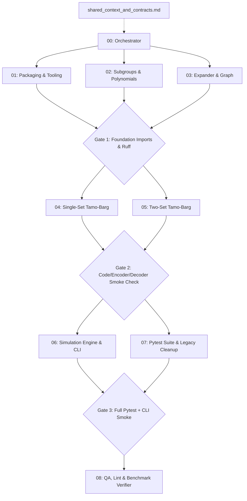

# `optimal_lrc` Multi-Agent Refactoring Swarm Prompts

This directory contains a complete, conflict-free **multi-agent swarm prompt suite** designed to refactor `optimal_lrc` into a modern, PEP 8–compliant, high-performance SageMath Python package (`src/optimal_lrc/`), resolve all **18 identified bugs (`B1`–`B18`)**, and implement **6 major algorithmic optimizations (`P1`–`P6`)**.

---

## Prompt Suite Contents

| File | Role | Wave | Owned Paths |
| :--- | :--- | :---: | :--- |
| [`shared_context_and_contracts.md`](./shared_context_and_contracts.md) | Shared API contracts, return-signature table, style guide, and full `B1`–`B18` / `P1`–`P6` manifest (inject into **every** agent's context) | All | *(Read-only reference)* |
| [`00_orchestrator.md`](./00_orchestrator.md) | **Lead Orchestrator Agent** coordinating Waves 1–4, inter-wave verification gates, and failure routing | Control | *(Coordinates workers)* |
| [`01_packaging_and_tooling.md`](./01_packaging_and_tooling.md) | **Packaging, Tooling & Docs Architect** | Wave 1 | `pyproject.toml`, `.gitignore`, `src/optimal_lrc/__init__.py`, `README.md` |
| [`02_subgroups_and_polynomials.md`](./02_subgroups_and_polynomials.md) | **Finite-Field Subgroups & Polynomial Algebra Specialist** | Wave 1 | `src/optimal_lrc/subgroups.py`, `src/optimal_lrc/polynomials.py` |
| [`03_expander_and_graph.md`](./03_expander_and_graph.md) | **Bipartite Coset Graph & Expander Specialist** | Wave 1 | `src/optimal_lrc/expander.py` |
| [`04_single_set_tamo_barg.md`](./04_single_set_tamo_barg.md) | **Single-Set Tamo–Barg Code, Encoder & Decoders Specialist** | Wave 2 | `src/optimal_lrc/tamo_barg.py` |
| [`05_two_set_tamo_barg.md`](./05_two_set_tamo_barg.md) | **Two-Set Tamo–Barg Code, Encoder & Decoders Specialist** | Wave 2 | `src/optimal_lrc/tamo_barg_two_sets.py` |
| [`06_simulations_refactor.md`](./06_simulations_refactor.md) | **Simulation Engine, Post-Processing & CLI Scripts Specialist** | Wave 3 | `src/optimal_lrc/simulation/*`, `simulation/*` (deletes `simulation/proces_results.py`) |
| [`07_tests_and_cleanup.md`](./07_tests_and_cleanup.md) | **Pytest Regression Suite & Legacy Cleanup Specialist** | Wave 3 | `tests/*`, deletes legacy `src/*.py` & `tests/*_Test.py` / `tests/TamoBarg_Expander*.py` |
| [`08_qa_and_benchmark_verifier.md`](./08_qa_and_benchmark_verifier.md) | **QA, Static Analysis & Performance Benchmark Verifier** | Wave 4 | *(Read-only verification & benchmark validation)* |

---

## Execution Topology



---

## Prerequisites (Target Execution Environment)

Run the swarm in an environment with **SageMath (9.5+ or 10.x)** installed, along with `networkx`, `matplotlib`, `pytest`, and `ruff` installed into SageMath's Python environment:

```bash
sage -python -m pip install pytest ruff networkx matplotlib
```

---

## How to Run the Swarm

### Option A: Automated Subagent Orchestration (Antigravity / Claude Code / Multi-Agent Runner)
Provide your primary agent with [`00_orchestrator.md`](./00_orchestrator.md) and [`shared_context_and_contracts.md`](./shared_context_and_contracts.md):

> *"Act as the Lead Orchestrator defined in `prompts/00_orchestrator.md`. Follow `prompts/shared_context_and_contracts.md` strictly and execute Waves 1 through 4 using parallel subagents for each wave."*

### Option B: Manual / Parallel Terminal Sessions
1. **Wave 1 (Parallel)**: Run Agents `01`, `02`, and `03` concurrently, attaching `shared_context_and_contracts.md` to each prompt.
2. **Install Editable Package**: Run `sage -python -m pip install -e . --no-build-isolation`.
3. **Wave 2 (Parallel)**: Run Agents `04` and `05` concurrently, attaching `shared_context_and_contracts.md` to each prompt.
4. **Wave 3 (Parallel)**: Run Agents `06` and `07` concurrently, attaching `shared_context_and_contracts.md` to each prompt.
5. **Wave 4 (Final Gate)**: Run Agent `08` to execute linting, formatting, regression tests (`B1`–`B18`), CLI smoke runs, and performance benchmarks.
