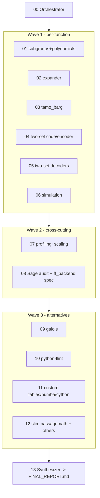

# Performance & SageMath-Alternatives Analysis Swarm

Analysis-only swarm: per-function algorithm review, deep performance analysis, and evaluation of replacements for the SageMath dependency. **No source changes.**

## Topology

## Files
| File | Purpose |
|---|---|
| [shared_context.md](shared_context.md) | inventory, baselines, methodology, per-function row schema |
| [00_orchestrator.md](00_orchestrator.md) | waves, gates |
| 01–06 | per-function analysts (every function owned by exactly one) |
| 07–08 | profiling; Sage surface audit |
| [alternatives_template.md](alternatives_template.md) + 09–12 | alternative evaluations |
| [13_synthesizer.md](13_synthesizer.md) | final report |

## Launch
Start one agent with `00_orchestrator.md` ("Read prompts/perf_analysis/shared_context.md and prompts/perf_analysis/00_orchestrator.md and execute it"). Outputs land in `reports/perf_analysis/`.
